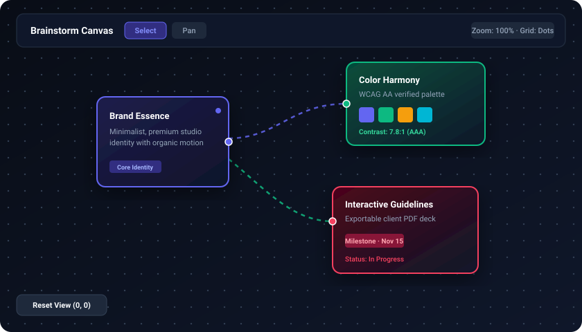
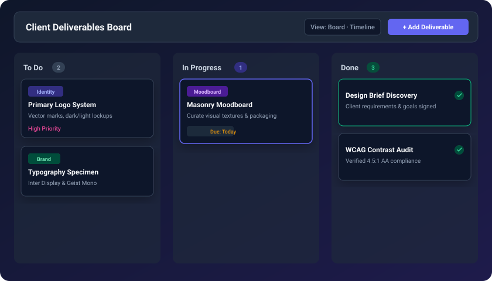
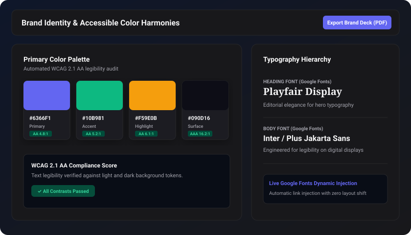

<div align="center">
  
  <h1>DesignFlow</h1>
  <p><strong>The Frictionless Creative Workspace for Designers &amp; Agencies</strong></p>

  <p>
    <a href="https://github.com/Mariyamalikho/Design-Flow-/stargazers"></a>
    <a href="https://github.com/Mariyamalikho/Design-Flow-/network/members"></a>
    <a href="https://github.com/Mariyamalikho/Design-Flow-/issues"></a>
    <a href="https://github.com/Mariyamalikho/Design-Flow-/pulls"></a>
  </p>
</div>

---

## 🎨 About The Project
**DesignFlow** is a modern Software-as-a-Service (SaaS) dashboard built specifically for graphic designers, branding specialists, and creative agencies. 

Unlike traditional platforms, DesignFlow is built with a **Local-First Architecture**. There are no login walls, no sign-ups, and no cloud latency. Anyone can instantly open the application, drag and drop inspiration into their moodboard, and start crafting brand identities securely on their own device.

---

## 📸 Interactive Feature Previews &amp; Demos

### 1. Guided Onboarding &amp; Studio Tour
A multi-step guided walkthrough for first-time designers introducing core studio workflows, complete with celebratory confetti cannon animations upon completion.
<p align="center">
  
</p>

### 2. Infinite Brainstorm Canvas &amp; SVG Dynamic Connectors
Freeform infinite zoom &amp; pan ideation surface powered by focal-point coordinate math, responsive node cards, and animated SVG connection paths. (See [Canvas Mathematical Architecture](docs/CANVAS_MATH.md)).
<p align="center">
  
</p>

### 3. Client Deliverables Kanban &amp; Milestone Timeline
Agile task management with drag-and-drop status workflows, priority tags, quick due date presets, milestone timeline grouping, and keyboard shortcuts (`?`, `N`, `Cmd+K`).
<p align="center">
  
</p>

### 4. Brand Systems, Image Color Extraction &amp; WCAG Contrast Auditing
Define color harmonies, automatically extract hex swatches from photography, verify text legibility with automated WCAG 2.1 AA ratios, and export ready-to-share PDF brand decks.
<p align="center">
  
</p>

---

### ✨ Key Features
- **Design Brief Wizard:** A multi-step form to capture client goals, target audience, and brand personality.
- **Interactive Moodboards:** Drag-and-drop masonry canvas for organizing visual inspiration with responsive asset cards.
- **Brainstorm Canvas:** Infinite visual workspace with focal-point zooming, SVG node connections, and hardware-accelerated pan transforms.
- **Rich Notes System:** Markdown &amp; rich-text project notes with TipTap editor, note templates, and debounced auto-save.
- **Brand Identity Builder:** Define typography pairings, Google Fonts dynamic loading, mission statements, and core values.
- **Accessible Color Palettes:** Real-time WCAG 2.1 AA/AAA contrast scoring with luminance calculations.
- **Kanban Task Board:** Manage project deliverables from Draft to Final Review with milestone timeline views.
- **PDF Export:** Generate professional, agency-quality Brand Guidelines presentations with one click.
- **GDPR Art. 20 Data Portability:** Export your entire workspace (projects, tasks, briefs, notes, canvas items, and media assets) as structured JSON or ZIP archive anytime.

---

## 💻 Tech Stack
- **Framework:** [React 19](https://react.dev/) + [Vite](https://vitejs.dev/)
- **Language:** [TypeScript](https://www.typescriptlang.org/)
- **Styling:** [Tailwind CSS](https://tailwindcss.com/)
- **Database:** Local-First via [IndexedDB (Dexie.js)](https://dexie.org/)
- **Routing:** [React Router](https://reactrouter.com/)
- **Editor:** [TipTap](https://tiptap.dev/)
- **Icons:** [Lucide React](https://lucide.dev/)
- **Testing:** [Vitest](https://vitest.dev/) + [React Testing Library](https://testing-library.com/)

---

## 🚀 Getting Started
To get a local copy up and running, follow these simple steps.

### Prerequisites
- Node.js (v18 or higher)
- npm or yarn

### Installation
1. Clone the repo:
   ```sh
   git clone https://github.com/Mariyamalikho/Design-Flow-.git
   ```
2. Navigate to the project directory:
   ```sh
   cd Design-Flow-
   ```
3. Install dependencies:
   ```sh
   npm install
   ```
4. Start the development server:
   ```sh
   npm run dev
   ```

---

## 🤝 Contributing
Contributions are what make the open-source community such an amazing place to learn, inspire, and create. Any contributions you make are **greatly appreciated**.

Please see our [CONTRIBUTING.md](./CONTRIBUTING.md) for full details on our Git workflow, how to open a Pull Request, and our coding standards.

---

## 📜 License
Distributed under the MIT License. See `LICENSE` for more information.

<div align="center">
  <p>Built with ❤️ by <a href="https://github.com/Mariyamalikho">Mariyam</a></p>
</div>
