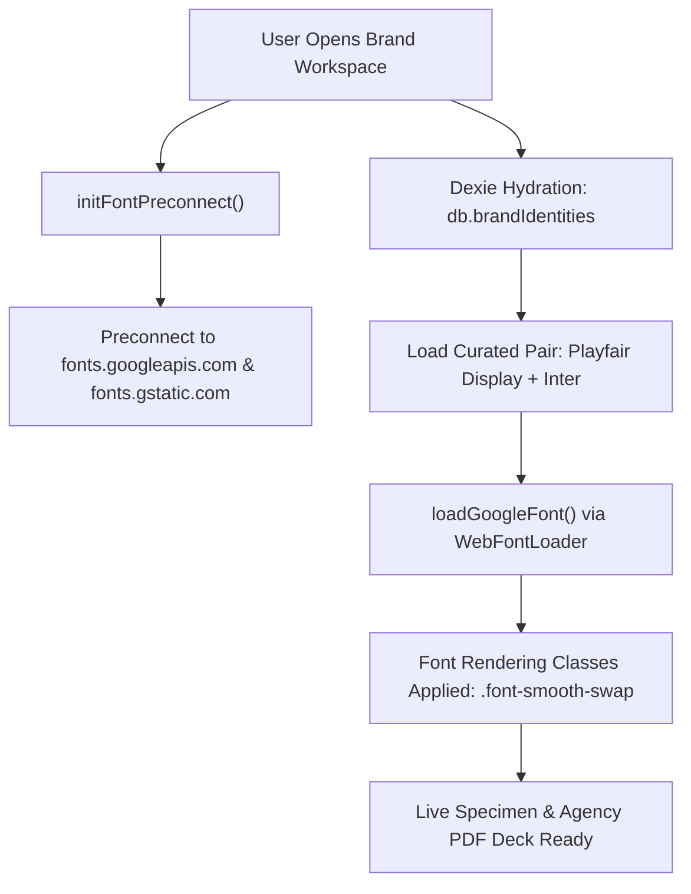

# Dynamic Font Loading & Brand Typography Strategy

## 1. Architectural Overview

DesignFlow's typography engine powers real-time font pairing, Google Fonts discovery, editorial brand voice articulation, and high-resolution agency deck generation. Because DesignFlow is built upon a **local-first, offline-capable architecture** (powered by IndexedDB via Dexie.js), the typography subsystem must deliver instantaneous visual feedback without causing layout shifts, blocked rendering threads, or UI flicker.



---

## 2. The FOUT (Flash of Unstyled Text) Mitigation System

### 2.1 The Problem
When loading dynamic web fonts, browsers traditionally render text using a generic system font until the target web font binary finishes downloading over the network. When the web font snaps into place, mismatched font metrics (ascent, descent, x-height, letter-spacing) cause jarring layout shifts (FOUT - Flash of Unstyled Text) or invisible text (FOIT - Flash of Invisible Text).

### 2.2 DesignFlow's Multi-Tier Mitigation Architecture

1. **Early DNS & TLS Preconnection (`initFontPreconnect()`)**:
   Injected early into the `<head>` lifecycle to establish early handshakes with Google Fonts origins:
   ```ts
   // Injected via initFontPreconnect()
   <link rel="preconnect" href="https://fonts.googleapis.com" />
   <link rel="preconnect" href="https://fonts.gstatic.com" crossorigin="" />
   ```

2. **Metric-Matched System Fallback Stacks (`getFontFallbackStack()`)**:
   Google Fonts are never paired with bare `serif` or `sans-serif` fallbacks. Instead, tightly calibrated system font stacks ensure text occupies near-identical geometric dimensions before the web font resolves:
   ```ts
   export function getFontFallbackStack(category: "sans-serif" | "serif" | "display" | "monospace"): string {
     switch (category) {
       case "serif":
         return '"Charter", "Bitstream Charter", "Sitka Text", "Cambria", "Georgia", "Times New Roman", serif';
       case "monospace":
         return '"SF Mono", "Segoe UI Mono", "Roboto Mono", "Ubuntu Mono", "Consolas", monospace';
       case "display":
         return '"Trebuchet MS", "Lucida Grande", "Impact", sans-serif';
       case "sans-serif":
       default:
         return '"Inter", -apple-system, BlinkMacSystemFont, "Segoe UI", "Roboto", "Helvetica Neue", sans-serif';
     }
   }
   ```

3. **CSS Font-Smoothing & Swap Directives**:
   All dynamic typography containers apply `.font-smooth-swap` and `.font-rendered`:
   ```css
   .font-smooth-swap {
     font-display: swap;
     transition: opacity 0.2s ease-in-out;
   }

   .font-rendered {
     text-rendering: optimizeLegibility;
     -webkit-font-smoothing: antialiased;
     -moz-osx-font-smoothing: grayscale;
   }
   ```

---

## 3. Dynamic On-Demand Font Loading Engine

### 3.1 Lazy-Loaded Catalogue Interaction
DesignFlow includes a curated catalogue of the 30+ most popular Google Fonts across serif, sans-serif, display, and monospace categories. To conserve bandwidth and device memory:
- **Starter Fonts Preload**: Starter pairs (`Inter`, `Playfair Display`, `Plus Jakarta Sans`, `Syne`, `Space Grotesk`) are preloaded asynchronously on mount.
- **Hover / Select Lazy Loading**: Catalogue specimen cards dynamically trigger `loadGoogleFont(fontFamily)` on mouse enter or font selection, caching loaded families in an in-memory map (`loadedGoogleFonts`) to avoid duplicate network fetches.

### 3.2 Dynamic WebFontLoader Integration
Fonts are dynamically loaded using `webfontloader` with active/inactive lifecycle promises:
```ts
export function loadGoogleFont(fontFamily: string, weights = [400, 600, 700]): Promise<boolean> {
  const cacheKey = `${fontFamily}:${weights.join(",")}`;
  if (loadedGoogleFonts.has(cacheKey)) return Promise.resolve(true);

  return new Promise((resolve) => {
    WebFont.load({
      google: {
        families: [`${fontFamily}:${weights.join(",")}:display=swap`],
      },
      active: () => {
        loadedGoogleFonts.add(cacheKey);
        resolve(true);
      },
      inactive: () => {
        resolve(false);
      },
      timeout: 3000,
    });
  });
}
```

---

## 4. Modular Type Scale Mathematics

DesignFlow automatically derives full typographic hierarchies from user-selected Heading and Body font sizes using continuous modular ratio math:

$$\text{Scale Ratio} = \sqrt[2]{\frac{\text{Heading Size (px)}}{\text{Body Size (px)}}}$$

```ts
export function calculateTypeScaleRatio(headingPx: number, bodyPx: number): number {
  if (!bodyPx || bodyPx <= 0) return 1.25;
  const ratio = Math.sqrt(headingPx / bodyPx);
  return Math.round(ratio * 100) / 100;
}
```

### Scale Hierarchy Table

| Level | Role | Size Calculation | Sample Ratio (36px / 16px) |
| :--- | :--- | :--- | :--- |
| **Display** | Hero Title | $\text{Heading} \times 1.33$ | $48\text{px}$ ($3.0\text{rem}$) |
| **H1** | Primary Heading | $\text{Heading Size}$ | $36\text{px}$ ($2.25\text{rem}$) |
| **H2** | Section Header | $\text{Heading} / \text{Ratio}$ | $24\text{px}$ ($1.5\text{rem}$) |
| **H3** | Subsection Header | $\text{Heading} / (\text{Ratio} \times 1.2)$ | $20\text{px}$ ($1.25\text{rem}$) |
| **Body** | Copy Regular | $\text{Body Size}$ | $16\text{px}$ ($1.0\text{rem}$) |
| **Caption** | Folios & Badges | $\text{Body} \times 0.75$ | $12\text{px}$ ($0.75\text{rem}$) |

---

## 5. Client-Side PDF Deck Generation & Asset Injection

### 5.1 Local Asset Pipeline
DesignFlow allows users to upload custom brand logos, emblems, and moodboard items stored as raw `Blob`s in IndexedDB (`db.assets`, `db.moodboardItems`). When generating the Brand Guidelines PDF deck:
1. `blobToDataUrl()` converts binary `Blob` instances into in-memory base64 `data:image/...;base64,...` strings.
2. The converted Data URLs are injected into the `<BrandGuidelinesPdfTemplate>` slides.
3. Canvas capture engines (`html2canvas`) read the images with zero CORS taint violations.

### 5.2 Dynamic Module Chunking
To prevent bloating the primary bundle, heavy PDF rendering dependencies (`jspdf` and `html2canvas`) are dynamically imported exclusively when an export is triggered via `exportDeckToPdf()`:
```ts
// Dynamically imported inside exportDeckToPdf()
const [{ jsPDF }, html2canvasModule] = await Promise.all([
  import("jspdf"),
  import("html2canvas")
]);
```
This reduces the core application bundle by over **600 kB** while keeping client-side PDF export 100% self-contained.

### 5.3 Print & PDF Page Break Anti-Clipping Rules
```css
@media print {
  @page {
    size: A4 landscape;
    margin: 0;
  }
  .brand-deck-slide {
    width: 297mm !important;
    height: 210mm !important;
    overflow: visible !important;
    page-break-after: always;
    break-after: page;
    break-inside: avoid;
  }
  .brand-deck-slide p,
  .brand-deck-slide h1,
  .brand-deck-slide h2,
  .brand-deck-slide h3,
  .brand-deck-slide card {
    page-break-inside: avoid !important;
    break-inside: avoid !important;
    orphans: 3;
    widows: 3;
  }
}
```

---

## 6. Offline Persistence & Reset Capability

- **Dexie.js Table**: `db.brandIdentities` tracks typography, mission, vision, core values, voice archetypes, tone attributes, and editorial rules indexed by `projectId`.
- **Debounced Auto-Save**: Textarea edits auto-save with an 800ms debounce cycle and mount hydration guards.
- **Restoration to Defaults**: Users can reset any project's brand guidelines to the curated baseline identity at any time via `getDefaultBrandIdentity()` and confirmation dialog.
